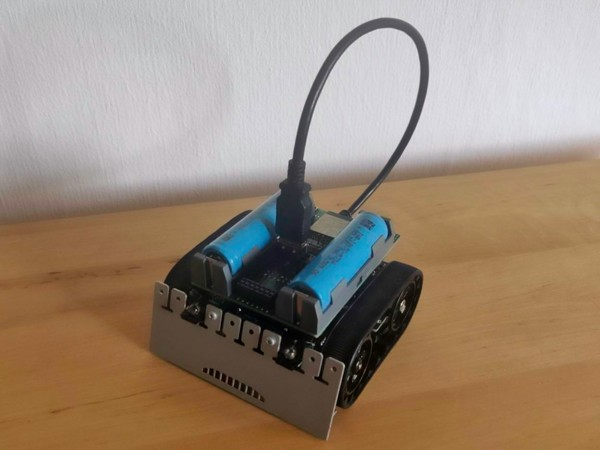

# Droid Control Ship - Firmware for ZumoComSystem <!-- omit in toc -->

[](http://choosealicense.com/licenses/mit/)
[](https://www.repostatus.org/#wip)
[](https://github.com/BlueAndi/DroidControlShip/releases)
[](https://github.com/BlueAndi/DroidControlShip/actions/workflows/main.yml)

The Droid Control Ship is the firmware running on the [ZumoComSystem](https://github.com/NewTec-GmbH/ZumoComSystem) hardware, which is a shield for the [Pololu 32U4 Zumo](https://www.pololu.com/product/2510) robot.

It provides different kind of exclusive applications, used for educational purposes:

- [Convoy Leader Robot](./doc/applications/ConvoyLeader/README.md) - Based on odometry information, it leads the followers to follow like a lemming trail.
- [Convoy Follower Robot](./doc/applications/ConvoyFollower/README.md) - It follows the leader by mainly reacting on the received information.
- [Remote Control](./doc/applications/RemoteControl/README.md) - Receives commands and motor speeds from an external source through MQTT.
- [Turtle](./doc/applications/Turtle/README.md) - A [ROS2](https://docs.ros.org/en/jazzy/index.html) robot controller that uses Twist messages like the ROS2 TurtleSim demo.
- [Line follower](./doc/applications/LineFollower/README.md) - Follows a track by a black line until the start/end line is passed twice.
- [LineFollowerSensorFusion](./doc/applications/LineFollowerSensorFusion/README.md) - Follows a black line and combines odometry, IMU and [SpaceShipRadar](https://github.com/NewTec-GmbH/SpaceShipRadar) data to estimate the robot's pose and velocity.
- [SensorFusion](./doc/applications/SensorFusion/README.md) - Estimates the robot's position from odometry and IMU data.
- [Slam](./doc/applications/Slam/README.md) - Exchanges robot telemetry and velocity commands with a TCP server.
- [Commissioning](./doc/applications/Commissioning/README.md) - Exercises the board peripherals in an observable way for hardware bring-up and validation.
- [Test](./doc/applications/Test/README.md) - Provides an application stub for the native test environment.

## Table of content <!-- omit in toc -->

- [The ZumoComSystem Shield](#the-zumocomsystem-shield)
- [The simulation](#the-simulation)
  - [Installation for simulation](#installation-for-simulation)
  - [How to start?](#how-to-start)
  - [Run](#run)
    - [Run with Webots launcher (recommended)](#run-with-webots-launcher-recommended)
    - [Run without Webots launcher](#run-without-webots-launcher)
    - [Run via terminal](#run-via-terminal)
- [The target](#the-target)
  - [Installation for target](#installation-for-target)
  - [Build and flash procedure](#build-and-flash-procedure)
- [The Applications](#the-applications)
- [Documentation](#documentation)
- [Used Libraries](#used-libraries)
- [Issues, Ideas And Bugs](#issues-ideas-and-bugs)
- [License](#license)
- [Contribution](#contribution)

## The ZumoComSystem Shield



It supports running in the [Webots simulation](https://www.cyberbotics.com/) too.

The Droid Control Ship communicates with the [Radon Ulzer](https://github.com/BlueAndi/RadonUlzer), which is the firmware running on the Pololu Zumo32U4 robot.

## The simulation

The simulation is based on the open source robot simulator *Webots*. The application and the services are equal to the target firmware. Only the HAL is different in the simulation.

- Website: <https://cyberbotics.com/#cyberbotics>
- Github: <https://github.com/cyberbotics/webots>


### Installation for simulation

1. Install the native compiler toolchain:
    - Linux
        - Install the gcc toolchain, depended on your distribution.
        - Install libmosquitto-dev, depended on your distribution.
    - Windows
        - Install the [MSYS2](https://www.msys2.org) toolchain.
        - Open MSYS2 shell.
            - Update package database: ```pacman -Sy pacman```
            - Install GCC: ```pacman -Sy mingw-w64-ucrt-x86_64-gcc```
            - Install Mosquitto: ```pacman -Sy mingw-w64-ucrt-x86_64-mosquitto```
            - Install OpenSSL: ```pacman -S mingw-w64-ucrt-x86_64-openssl```

### How to start?

After you built the application, you will find it in ```.pio/build/<APPLICATION-NAME>/program[.exe]```. It provides several command line arguments to configure certain features. Use -h or --help to get a short user friendly overview about them.

The applications are using a configuration file in JSON format to retrieve certain settings. In the very first run, such a configuration file will be automatically be created. If there exists already one, it will be loaded without modifications (regardless of any other program arguments).

The DroidControlShip will always try to connect to [RadonUlzer](https://github.com/BlueAndi/RadonUlzer), therefore its important to have the RadonUlzer executable started first! And because the RadonUlzer executable will always connect to the Webots simulation, it shall run as well having a corresponding world loaded.

Some applications require to have an MQTT server running, but it may depend on the kind of application you choose.

A complete deployment, including MQTT server, would be started in the following way:

MQTT Broker --> Webots World --> [RadonUlzer](https://github.com/BlueAndi/RadonUlzer) --> DroidControlShip

In order to simplify this process, the [Launcher](https://github.com/gabryelreyes/Launcher) project is under active development.

### Run

There are 3 ways how to run now the application. Choose according to your needs.

#### Run with Webots launcher (recommended)

The Webots launcher is recommended to connect to the simulation.

It is mandatory if the simulation contains more than one robot. The robot is identified by its name. Adapt the robot name in the [platformio_override.ini](./platformio_override.ini), see *webots_robot_name*.

The Webots documentation has more details about [Single Simulation and Multiple Local Extern Robot Controllers](https://cyberbotics.com/doc/guide/running-extern-robot-controllers?tab-os=windows#single-simulation-and-multiple-local-extern-robot-controllers).

It is mandatory too if the simulation does not run locally (e.g. Webots runs on windows host and [RadonUlzer](https://github.com/BlueAndi/RadonUlzer) in WSL).
Set the IP address and the port in [platformio_override.ini](./platformio_override.ini), see *webots_ip_address* and *webots_protocol*.

Use *ipc* as *webots_protocol* for local connections and *tcp* for remote connections.

| Key                 | Description                                                                                      |
| ------------------- | ------------------------------------------------------------------------------------------------ |
| webots\_ip\_address | The IP address of the Webots simulation, which is used for TCP communication.                    |
| webots\_protocol    | \[ipc\|tcp\] - ipc is faster but only works on the same machine, tcp works also over network.    |
| webots\_robot\_name | The robot name used to identify the robot in the Webots world. See Webots world robot prototype. |

PlatformIO project tasks --> &lt;APP-NAME&gt; --> Custom --> Launch

#### Run without Webots launcher

This can be chosen in case the simulation waits just for one robot.

PlatformIO project tasks --> &lt;APP-NAME&gt; --> General --> Upload

#### Run via terminal

1. Open a command line (shell) and change to the folder with the built executable in ```.pio/build/<APPLICATION-NAME>```. This folder contains all necessary shared libraries as well.
2. Start the ```program[.exe]``` executable.

## The target

The main target of the firmware is the [ZumoComSystem](https://github.com/NewTec-GmbH/ZumoComSystem) from NewTec GmbH, which is a shield for the [Pololu 32U4 Zumo](https://www.pololu.com/product/2510) robot.

Together with [Radon Ulzer](https://github.com/BlueAndi/RadonUlzer) it can be run in the [Webots simulation](https://www.cyberbotics.com/) too.


### Installation for target

1. Make sure that the hardware version of your [ZumoComSystem](https://github.com/NewTec-GmbH/ZumoComSystem) is supported. Currently, v1 (v1.1 and v1.2), v2 and [v3](https://github.com/NewTec-GmbH/ZumoComSystemHW) are supported. Select the hardware version in the ```[target:esp32]``` section of ```platformio.ini```.
2. Install the [drivers](https://www.silabs.com/developers/usb-to-uart-bridge-vcp-drivers?tab=downloads) for the CP2102 USB-UART converter if required. The "CP210x Universal Windows Driver" is recommended, as it enables the automatic bootloader mode.

### Build and flash procedure

1. Build the firmware using the ```Build``` task in the "PlatformIO Project Tasks"
    - For the target use only the applications with "Target" as postfix, e.g. LineFollowerTarget.
2. Upload the firmware to the ZumoComSystem using the ```Upload``` task in the "PlatformIO Project Tasks" tab, or the arrow on the bottom task bar.
3. After successfully uploading the firmware, the configuration has to be uploaded to the filesystem. Make sure that the information in ```data/config/config.json``` matches your setup. Upload the configuration using the ```Upload Filesystem Image``` task in the "PlatformIO Project Tasks" tab.

Note that the robotName can be left empty in case you want the MAC address of the hardware to be used as the name. In case you prefer to give the robot a more descriptive name, can set the name. Beware, if you use multiple robots, you will have to give each a different name manually.

In a similar way, not providing a WiFi configuration will force the target into going into Access Point Mode. In a future update it will be possible to update the WiFi credentials using this mode and an on-board web server.

## The Applications

| Application                                                                       | Standalone | Zumo32U4 Robot Required | [RadonUlzer](https://github.com/BlueAndi/RadonUlzer) Application | MQTT Broker Required                 |
| --------------------------------------------------------------------------------- | ---------- | ----------------------- | ---------------------------------------------------------------- | ------------------------------------ |
| [Commissioning](./doc/applications/Commissioning/README.md)                       | Yes        | No                      | N/A                                                              | No                                   |
| [ConvoyLeader](./doc/applications/ConvoyLeader/README.md)                         | No         | Yes                     | ConvoyLeader                                                     | Yes                                  |
| [ConvoyFollower](./doc/applications/ConvoyFollower/README.md)                     | No         | Yes                     | RemoteControl                                                    | Yes                                  |
| [LineFollower](./doc/applications/LineFollower/README.md)                         | No         | Yes                     | RemoteControl                                                    | No                                   |
| [LineFollowerSensorFusion](./doc/applications/LineFollowerSensorFusion/README.md) | No         | Yes                     | RemoteControl                                                    | Yes                                  |
| [RemoteControl](./doc/applications/RemoteControl/README.md)                       | No         | Yes                     | RemoteControl                                                    | Yes                                  |
| [SensorFusion](./doc/applications/SensorFusion/README.md)                         | No         | Yes                     | SensorFusion                                                     | Yes                                  |
| [Slam](./doc/applications/Slam/README.md)                                         | No         | Yes                     | RemoteControl                                                    | No (TCP server required)             |
| [Test](./doc/applications/Test/README.md)                                         | Yes        | No                      | N/A                                                              | No                                   |
| [Turtle](./doc/applications/Turtle/README.md)                                     | No         | Yes                     | RemoteControl                                                    | No (ROS2 + Micro-ROS Agent required) |

## Documentation

- [SW Architecture](./doc/architecture/README.md)
- [SW Configuration](./doc/configuration/README.md)
- [Coding Guideline](./doc/CodingGuideline.md)

## Used Libraries

| Library                                                                                        | Description                                                                                                             | License                 |
| ---------------------------------------------------------------------------------------------- | ----------------------------------------------------------------------------------------------------------------------- | ----------------------- |
| [Arduino-ESP32](https://github.com/espressif/arduino-esp32)                                    | Arduino framework for ESP32 targets.                                                                                    | LGPL-2.1                |
| [ArduinoEigen](https://github.com/hideakitai/ArduinoEigen)                                     | Eigen linear algebra library for Arduino, used by sensor fusion.                                                        | MPL-2.0                 |
| [ArduinoJson](https://arduinojson.org/)                                                        | JSON handling.                                                                                                          | MIT                     |
| [ArduinoNative](https://github.com/BlueAndi/ArduinoNative)                                     | Arduino interfaces for native simulation and tests.                                                                     | MIT                     |
| [micro_ros_platformio](https://github.com/gabryelreyes/micro_ros_platformio)                   | PlatformIO integration for micro-ROS on the Turtle target.                                                              | Apache-2.0              |
| [Mosquitto](https://mosquitto.org/)                                                            | MQTT client library used by the simulation.                                                                             | EPL-2.0 OR BSD-3-Clause |
| [NTPClient](https://github.com/arduino-libraries/NTPClient)                                    | NTP client declared for the LineFollowerSensorFusion target.                                                            | MIT                     |
| [PlatformIO](https://platformio.org)                                                           | Cross-platform build and development tooling.                                                                           | Apache-2.0              |
| [PlatformIO Espressif 32](https://github.com/platformio/platform-espressif32)                  | PlatformIO platform package for ESP32 targets.                                                                          | Apache-2.0              |
| [PubSubClient3](https://github.com/hmueller01/pubsubclient3)                                   | MQTT publish/subscribe client for ESP32 targets.                                                                        | MIT                     |
| [SerialMuxProt](https://github.com/gabryelreyes/SerialMuxProt)                                 | Multiplexing communication protocol.                                                                                    | MIT                     |
| [USB_Host_Shield_2.0](https://github.com/NewTec-GmbH/USB_Host_Shield_2.0/tree/3_Endpoints_ACM) | USB host controller driver; a fork of the [original](https://github.com/felis/USB_Host_Shield_2.0) with endpoint fixes. | GPLv2                   |
| [Webots](https://github.com/cyberbotics/webots)                                                | Robot simulation and controller API.                                                                                    | Apache-2.0              |

## Issues, Ideas And Bugs

If you have further ideas or you found some bugs, great! Create a [issue](https://github.com/BlueAndi/DroidControlShip/issues) or if you are able and willing to fix it by yourself, clone the repository and create a pull request.

## License

The whole source code is published under the [MIT license](http://choosealicense.com/licenses/mit/).
Consider the different licenses of the used third party libraries too!

## Contribution

Unless you explicitly state otherwise, any contribution intentionally submitted for inclusion in the work by you, shall be licensed as above, without any
additional terms or conditions.
